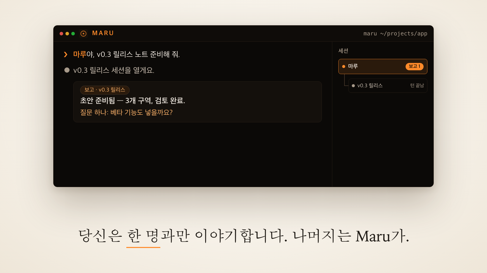

[English](README.md) | 한국어 | [简体中文](README.zh-CN.md)

# Maru

**에이전트는 여럿, 대화는 하나.**

Maru는 여러 에이전트를 맡아 주는 총괄 비서입니다. 일은 나눠 맡기고, 누가 무엇을 했는지 기억해 두었다가, 한 사람처럼 답합니다. Claude Code를 실행하는 macOS 데스크톱 앱(Electron, 아래에 셸·Python 스크립트)이라서 이미 쓰는 Claude 구독으로 동작합니다. 추가 API 키는 필요 없습니다.

[](site/assets/maru-promo-ko.mp4)

## 이렇게 말해 보세요

> 마루야, v0.3 릴리스 노트 준비해 줘.
>
> 마루야, 릴리스 노트 어떻게 하기로 했지?
>
> 마루야, 오늘 남은 일 뭐야?

## 무엇이 달라지나

- **한 명과만 이야기하면 됩니다. 나머지는 Maru가 맡습니다.** Maru에게 일을 맡기세요. 승인하면 Maru 아래에 그 프로젝트의 세션이 열리고, 일을 마친 세션은 보고를 올립니다. Maru는 그 결과를 하나로 정리해 답하고, 판단이 필요한 부분만 물어봅니다.
- **한 번만 물어보면 됩니다.** "릴리스 노트 어떻게 하기로 했지?" Maru가 결정과 날짜, 프로젝트를 함께 알려 줍니다. 지난 세션을 뒤질 필요가 없습니다.
- **아침에 열면 이미 정리돼 있습니다.** 할 일, 프로젝트, 어제의 일지가 입력하기 전에 이미 채워져 있습니다. 어느 폴더에서 일했든 한곳에 모입니다.
- **쓸수록 일을 더 잘합니다.** 같은 일을 세 번째 하면 Maru가 스킬로 만들자고 제안합니다. 승인하면 다음부터는 한 줄이면 됩니다.

## 어떻게 동작하나

**기억은 세 층입니다.** 메모를 한 더미로 쌓지 않습니다. 층마다 역할이 있습니다.

| 층 | 비유 | 담는 것 |
| --- | --- | --- |
| 지금 | 작업 기억 | 이 대화. 지금 하고 있는 일. |
| 오늘 | 단기 기억 | 일지. 한 일, 결정, 남은 일. 세션이 끝나면 대신 적어 둡니다. |
| 오래 | 장기 기억 | 변하지 않는 것들: 선호, 프로젝트, 일하는 방식. |

매일 밤 03:30에 예약된 작업이 정리합니다. 겹치는 것은 합치고, 중요한 것은 남기고, 나머지는 뒤로 물립니다. 이 구조는 사람의 기억을 설명하는 방식(작업 기억, 단기 기억, 장기 기억, 수면 중 정리)에서 빌려 왔습니다. 설계의 영감일 뿐, 성과에 대한 주장이 아닙니다.

**달력으로 돌아봅니다.** 앱에서 날짜를 고르면 그날 한 일, 결정, 남은 일이 프로젝트별로 보입니다. 새벽 정리는 최근 며칠의 하루 회고도 짧은 글로 적어 둡니다(한 번에 최대 이틀 치). 그날 일지에 적힌 것만 근거로 씁니다. 캘린더 접근을 켜면 그날 일정도 함께 보이고, 일정은 메모리에만 두고 디스크에 저장하지 않습니다.

**프로젝트 세션과 보고.** Maru는 프로젝트 폴더에 자기 아래로 세션을 열고 브리핑을 넘길 수 있습니다. 열기 전에 확인 창이 맡길 내용을 그대로 보여 주며, **열기**를 눌러야 세션이 시작됩니다. 세션이 한 턴을 마칠 때마다 보고가 남고, Maru는 다음에 말을 걸 때 그 내용을 전합니다. 보고는 지시가 아니라 검증되지 않은 데이터로 다룹니다.

**여러 세션을 한 화면에서 오갑니다.** 왼쪽 목록에 Maru와 프로젝트 세션이 상태와 함께 보입니다. 아직 보지 않은 답변이 있는 세션에는 주황 점이 붙고, 열면 사라집니다. 세션 순서는 끌어서 바꾸고, 패널 너비는 경계를 끌어 조절합니다. ⌘⇧↑/↓로 위아래 세션으로 옮기고, ⌘⇧←/→로 묶음을 접고 펼치며, ⌘↑/↓로 입력 중인 글의 맨 앞과 끝으로 갑니다. 입력란에 `->`, `<-`, `<->`를 치면 →, ←, ↔로 바뀝니다.

**스킬과 팀은 제안으로만 생깁니다.** 회고가 낸 스킬 제안에는 일이 끝났는지 확인할 항목이 붙습니다. 실행 결과나 원본과의 대조처럼 증거로 확인되는 것만 적습니다. 스킬로 만든 결과를 고쳐 달라고 하면, 그 교정은 기억이 아니라 그 스킬의 수정안으로 제안됩니다. 스쿼드의 팀원마다 미리 읽을 스킬을 지정할 수 있습니다. 어느 것도 승인하기 전에는 설치되지 않습니다.

**프로젝트마다 설계 문서 하나.** 목표, 결정, 아직 정하지 않은 것, 현재 상태가 일반 Markdown 파일 하나에 담기고, Maru와 모든 프로젝트 세션이 그 문서를 읽습니다. 그래서 모두 같은 사실을 바탕으로 일합니다. 직접 읽고 고칠 수도 있습니다.

**모두 내 Mac의 일반 파일입니다.** 기억, 일지, 설계 문서는 읽을 수 있는 글입니다. 기억에는 바뀐 이력을 보고 되돌릴 수 있는 기록이 있습니다. Maru는 Claude Code를 통해 동작하므로, 대화는 지금까지와 같은 방식으로 Claude에 전달됩니다.

## 요구사항

- Apple Silicon(arm64)의 macOS 15 이상. Intel 빌드는 없습니다.
- [Claude Code](https://claude.com/claude-code) 설치, 그리고 로그인된 Claude 구독.
- 명령줄 도구: `git`, `python3`, `jq`, `perl`. `jq`는 macOS 15 이상에 기본으로 들어 있습니다. Maru는 각 도구가 있는지만이 아니라 실제로 실행되는지 확인합니다.

## 설치

### 방법 A: 한 줄 설치(권장)

터미널을 열고 실행합니다.

```
curl -fsSL https://jamm0316.github.io/maru/install.sh | bash
```

하는 일:

- GitHub Releases에서 릴리스 dmg를 내려받습니다(버전은 스크립트에 고정되어 있습니다).
- SHA-256을 스크립트에 적힌 값과 비교하고, 다르면 멈춥니다.
- Maru를 `/Applications`에 복사합니다(쓸 수 없으면 `~/Applications`). `sudo`는 쓰지 않고, 실행 중인 Maru는 건드리지 않습니다. 이미 설치되어 있으면 먼저 묻고, 기존 앱은 휴지통으로 옮깁니다.
- Maru를 엽니다. 처음 실행하면 Maru가 필요한 것을 확인하고, 무엇을 바꾸는지 보여 주며, 단계마다 직접 확인을 받습니다.

이 스크립트는 macOS의 내려받기 확인을 건너뛰고(`curl`로 받은 파일에는 격리 표시가 붙지 않습니다), 앱은 서명도 공증도 되어 있지 않습니다. 즉 이 저장소를 신뢰하는 선택입니다. 먼저 스크립트를 읽어 보세요: [site/install.sh](site/install.sh).

### 방법 B: dmg 직접 받기

1. [Releases](../../releases)에서 최신 `.dmg`를 내려받아 Maru를 응용 프로그램 폴더로 끌어다 놓습니다.
2. 엽니다. 처음 실행하면 Maru가 필요한 것을 확인하고, 무엇을 바꾸는지 보여 주며, 단계마다 직접 확인을 받습니다.

#### macOS에서 처음 실행할 때

dmg는 **서명도 공증도 되어 있지 않아서**, 브라우저로 받은 dmg는 처음에 macOS가 막습니다. macOS 15에서는 이렇게 합니다.

1. macOS가 “Maru.app이(가) 열리지 않음” 창을 띄웁니다. “휴지통으로 이동”이 아니라 **완료**를 누릅니다.
2. 시스템 설정 > 개인정보 보호 및 보안을 엽니다.
3. 아래로 내려 보안 항목에서 Maru 안내 옆의 **그래도 열기**를 누릅니다.
4. 암호 또는 Touch ID로 확인합니다.

또는 터미널에서 격리 속성을 지웁니다.

```
xattr -dr com.apple.quarantine /Applications/Maru.app
```

어느 쪽이든 서명되지 않은 빌드를 신뢰하겠다고 직접 선택하는 것입니다. 그러고 싶지 않다면 소스에서 직접 빌드하고 코드를 먼저 읽어 보세요(아래).

### 방법 C: 소스에서 실행

```
git clone <이 저장소>
cd maru/app
npm install      # node-pty도 다시 빌드합니다. Node.js와 Xcode Command Line Tools가 필요합니다
# 선택: `npm run build:native` 으로 EventKit 캘린더 도우미를 빌드합니다(Swift 필요). 패키징한 앱이 이 도우미를 씁니다. 소스로 실행할 때는 `MARU_APP_CAL_HELPER=1` 을 주지 않으면 느린 AppleScript 방식으로 읽습니다
npm start
```

### 방법 D: 명령줄만 사용(앱 없이)

저장소 폴더에서 먼저 미리 보고 설치합니다. 다시 실행해도 안전합니다.

```
./install.sh --dry-run   # 할 일만 출력하고 아무것도 바꾸지 않습니다
./install.sh
```

선택 옵션: `--with-cli`는 `bin/maru`를 `~/.local/bin`(또는 `$MARU_BIN_DIR`)에 링크하고, `--with-cmux`는 cmux Dock 설정을 설치합니다. `--with-telegram`은 선택 기능인 텔레그램 연동용 로그인 작업(`com.maru.telegram`)을 등록하며, 1회 설정을 마친 뒤에만 등록됩니다(설명서 참고). 모두 기본값은 꺼짐입니다.

## 내 컴퓨터에서 바뀌는 것

`install.sh`는 아래 일을 하고, 단계마다 화면에 출력합니다.

- 저장소 폴더에 `data/`를, 기억 폴더(`~/.claude/projects/<슬러그>/memory/`)를 만듭니다.
- `~/.claude/settings.json`에 훅 4개를 추가합니다: SessionEnd(회고), SessionStart(최근 일지 불러오기), Stop과 PreCompact(세션 도중 일지). 파일을 JSON으로 읽어 다시 쓰므로 주석처럼 JSON 밖의 서식은 보존되지 않습니다. 수정 전에 타임스탬프 백업을 `data/backups/`에 둡니다.
- 밤사이 정리를 돌리는 launchd 작업 `com.maru.dream`을 등록합니다.
- `recall` 스킬을 `~/.claude/skills/recall`에 복사합니다(Maru가 설치하지 않은 기존 `recall`은 건드리지 않습니다).
- 저장소의 `.claude/settings.local.json`에, 거기서 실행한 세션이 홈 폴더에 접근할 수 있도록 허용을 적습니다.
- `~/.claude/CLAUDE.md`에 표시된 블록(`<!-- maru:begin -->`부터 `<!-- maru:end -->`까지) 하나를 유지합니다.

**되돌리려면:** `./uninstall.sh`(`--dry-run`도 지원합니다). 설치가 한 일만 되돌립니다. 훅 4개, launchd 작업(등록했다면 텔레그램 로그인 작업도), `CLAUDE.md` 블록, Maru 표식이 있는 `recall` 복사본, 홈 접근 항목, `~/.maru-work`입니다. `data/`(개인 데이터, 변경 이력, 백업)와 기억 폴더는 남깁니다. 없애려면 직접 지우세요.

## 신뢰와 한계

- **Maru가 요청한 세션은 직접 승인해야 열립니다.** Maru는 혼자 세션을 열지 않습니다. 확인 창이 맡길 내용을 보여 주고, 열기를 누르기 전에는 아무것도 시작되지 않습니다. 앱에서 Maru 아래에 세션을 직접 열 수도 있습니다. 완전 자율 시스템이 아닙니다.
- **dmg는 서명·공증되어 있지 않습니다.** 위의 "macOS에서 처음 실행할 때"를 보세요.
- **세션 사이의 비밀은 아닙니다.** Maru와 세션 사이의 요청에는 서명이 붙지만, 같은 macOS 사용자 계정 안에서 그 키는 비밀이 아닙니다. 진짜 안전장치는 서명이 아니라 확인 창입니다.
- **마음대로 설치하지 않습니다.** Maru는 스킬을 제안만 하고, 설치는 승인한 뒤에만 합니다.
- **구독 사용량을 씁니다.** 세션이 끝난 뒤의 회고와 밤사이 정리는 각각 Claude를 호출하며 사용량에 포함됩니다. 아직 조절하는 설정은 없습니다. 멈추려면 `./uninstall.sh`를 실행해 훅과 밤사이 작업을 제거합니다. 로그인이 만료되면 다시 로그인할 때까지 회고가 실패합니다.
- **구독 약관은 바뀔 수 있습니다.** 자동 호출(훅과 예약 작업)이 사용 중인 요금제 약관에 맞는지 직접 확인하세요.
- **내장 스쿼드는** `dev`와 `research`뿐입니다. 그 외 스쿼드는 Maru가 초안을 만들거나(앱에서 문장 하나로 요청하거나, 회고가 제안) 직접 작성한 것이며, 승인한 뒤에만 설치됩니다.
- **Maru 폴더 밖에서는 상태를 알 수 없을 수 있습니다.** 앱이 다른 폴더에서 여는 세션에는 그 세션에만 상태 훅을 붙입니다(전역 설정은 바꾸지 않습니다). 훅을 붙이지 못한 경우, 예를 들어 그 터미널에서 `claude`를 직접 다시 실행한 경우에는 상태가 "알 수 없음"으로 보입니다.
- **프롬프트 인젝션을 완전히 막을 수는 없습니다.** 웹이나 붙여넣은 문서의 문장이 세션에 섞여 들어올 수 있습니다. 회고는 제한된 권한 목록으로 돌고 확인·되돌리기용 변경 이력을 남기지만, 기억 폴더를 공개로 공유하지 마세요.
- **Claude 전용, macOS 전용입니다.** Claude Code와 Claude 구독이 필요하며, Apple Silicon의 macOS에서만 동작합니다.

## 문서

전체 운영 설명서는 [docs/manual.ko.md](docs/manual.ko.md)입니다. CLI(`maru doctor`, `maru status` 등), 설정, 스쿼드, 선택 기능인 텔레그램 연동, 권한 모델을 다룹니다.

## 기여

이슈와 풀 리퀘스트를 환영합니다. 테스트는 로컬에서 돌며 네트워크가 필요 없습니다.

```
cd app && npm test
scripts/test-squads.sh
scripts/test-lang.sh
scripts/test-env.sh
```

`scripts/test-*.sh`가 더 있으니 건드린 부분의 것을 돌려 주세요. 개인 정보(이름, 홈 절대 경로, 이메일)는 커밋에 넣지 마세요.

## 라이선스

[MIT](LICENSE)
