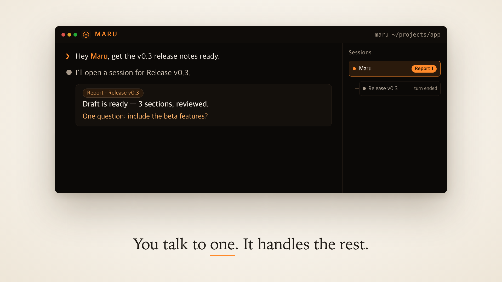

English | [한국어](README.ko.md) | [简体中文](README.zh-CN.md)

# Maru

**Many agents. One conversation.**

Maru is a chief of staff for your agents. It hands the work out, remembers who did what, and answers you as one. It is a macOS desktop app (Electron, with shell and Python scripts underneath) that runs Claude Code, so it works on the Claude subscription you already have. No extra API keys.

[](site/assets/maru-promo.mp4)

## Try saying

> Hey Maru, get the v0.3 release notes ready.
>
> Hey Maru, what did we decide about the release notes?
>
> Hey Maru, what's left for today?

## What you get

- **You talk to one. It handles the rest.** Give Maru the job. With your go-ahead, it opens a session for the project under itself. The session does the work and reports back, and Maru answers you as one, with a single question when a judgment call is yours.
- **Ask once. It's there.** "What did we decide about the release notes?" Maru answers with the decision, the day and the project. No digging through old sessions.
- **Start every morning already caught up.** Todos, projects and yesterday's journal are filled in before you type a word, from every folder you worked in.
- **It gets better at your work.** When you do the same thing a third time, Maru offers to turn it into a skill. You approve, and next time it takes one line.

## How it works

**Memory, in three layers.** Not one big pile of notes. Each layer has a job.

| Layer | Like | What it holds |
| --- | --- | --- |
| Now | Working memory | This conversation. What you are working on right now. |
| Today | Short-term memory | The journal: done, decided, still open. Written for you when a session ends. |
| For good | Long-term memory | What stays true: your preferences, your projects, how you like things done. |

Every night at 03:30 a scheduled job tidies up: duplicates merge, what mattered is kept, the rest steps back. The structure borrows from how human memory is described (working, short-term and long-term memory, and consolidation during sleep). It is a design inspiration, not a claim about results.

**A calendar to look back through.** Pick a day in the app and see what was done, decided and left open, grouped by project. The nightly job also writes a short daily note for recent days (at most two per run), built only from that day's journal lines. If you turn on Calendar access, that day's events are shown beside it; they are kept in memory and never saved to disk.

**Project sessions and reports.** Maru can open a session in a project folder under itself and hand it a briefing. Before it opens, a confirmation window shows exactly what will be handed over, and the session starts only when you click **Open**. When the session ends, it leaves a report, and Maru passes it on to you on your next message. Reports are treated as unverified data, not as instructions.

**One design doc per project.** Goals, decisions, open questions and current state live in one plain Markdown file that Maru and every project session read, so they work from the same facts. You can read and edit it too.

**Everything is plain files on your Mac.** Memory, the journal and the design docs are readable text. Memory has a change history you can browse and undo. Maru works through Claude Code, so your conversations go to Claude the same way they already do.

## Requirements

- macOS 15 or later on Apple Silicon (arm64). No Intel build.
- [Claude Code](https://claude.com/claude-code) installed, and a Claude subscription you are logged in with.
- Command-line tools: `git`, `python3`, `jq` and `perl`. `jq` ships with macOS 15 and later. Maru checks that each tool actually runs, not just that it exists.

## Install

### Option A: one-line install (recommended)

Open Terminal and run:

```
curl -fsSL https://jamm0316.github.io/maru/install.sh | bash
```

What it does:

- Downloads the release dmg from GitHub Releases (the version is pinned in the script).
- Checks its SHA-256 against the value in the script, and stops if it does not match.
- Copies Maru to `/Applications` (or `~/Applications` if that is not writable). It never uses `sudo`, and it will not touch a running Maru. If Maru is already installed, it asks first and moves the old copy to the Trash.
- Opens Maru. On first run Maru checks what it needs, shows what it will change, and asks you to confirm each step.

The script skips macOS's download check (files fetched with `curl` are not quarantined), and the app is not signed or notarized. So you are trusting this repository. Read the script first: [site/install.sh](site/install.sh).

### Option B: download the dmg

1. Download the latest `.dmg` from [Releases](../../releases) and drag Maru to Applications.
2. Open it. On first run Maru checks what it needs, shows what it will change, and asks you to confirm each step.

#### First launch on macOS

The dmg is **not signed or notarized**, so macOS blocks a dmg downloaded in a browser the first time. On macOS 15:

1. macOS shows "Maru.app Not Opened". Click **Done**, not Move to Trash.
2. Open System Settings, then Privacy & Security.
3. Scroll to Security and click **Open Anyway** next to the Maru message.
4. Confirm with your password or Touch ID.

Or remove the quarantine attribute in a terminal:

```
xattr -dr com.apple.quarantine /Applications/Maru.app
```

Either way, you are choosing to trust an unsigned build. If you would rather not, build from source (below) and read the code first.

### Option C: run from source

```
git clone <this repository>
cd maru/app
npm install      # also rebuilds node-pty; needs Node.js and Xcode Command Line Tools
npm start
```

### Option D: command line only (no app)

From the repository folder, preview first, then install. Running it again is safe.

```
./install.sh --dry-run   # prints what it would do, changes nothing
./install.sh
```

Optional flags: `--with-cli` links `bin/maru` into `~/.local/bin` (or `$MARU_BIN_DIR`); `--with-cmux` installs a cmux Dock config. Both are off by default.

## What it changes on your machine

`install.sh` does the following, and prints each step as it goes:

- Creates `data/` in the repository folder and the memory folder (`~/.claude/projects/<slug>/memory/`).
- Adds four hooks to `~/.claude/settings.json`: SessionEnd (reflection), SessionStart (loads the recent journal), and Stop and PreCompact (journal during a session). The file is read and rewritten as JSON, so formatting outside JSON (such as comments) is not kept. A timestamped backup goes to `data/backups/` first.
- Registers a launchd job, `com.maru.dream`, that runs the nightly tidy-up.
- Copies the `recall` skill to `~/.claude/skills/recall` (an existing `recall` that Maru did not install is left alone).
- Writes `.claude/settings.local.json` in the repository to give sessions run there access to your home folder.
- Keeps one marked block (`<!-- maru:begin -->` to `<!-- maru:end -->`) in `~/.claude/CLAUDE.md`.

**To undo it:** `./uninstall.sh` (it also accepts `--dry-run`). It reverses only what the installer did: the hook, the launchd job, the `CLAUDE.md` block, the `recall` copy that carries Maru's marker, the home-access entry, and `~/.maru-work`. It leaves `data/` (your personal data, change history and backups) and the memory folder in place. Delete those yourself if you want them gone.

## Trust and limits

- **Every project session needs your click.** Maru never opens a session on its own. A confirmation window shows what will be handed over, and nothing starts until you click Open. It is not a fully autonomous system.
- **The dmg is not signed or notarized.** See "First launch on macOS" above.
- **Not a secret between sessions.** Requests between Maru and its sessions carry a signature, but within the same macOS user account that key is not a secret. The confirmation window is the real safeguard, not the signature.
- **Nothing installs on its own.** Maru proposes skills; you approve them.
- **It uses your subscription's usage.** Reflection after a session and the nightly tidy-up each make Claude calls that count toward your usage. There is no setting to tune them yet; to stop them, run `./uninstall.sh`, which removes the hooks and the nightly job. If your login expires, reflection fails until you log in again.
- **Subscription terms may change.** Check for yourself that automated calls (hooks and a scheduled job) fit your plan's terms.
- **Built-in squads:** only `dev` and `research`. Further squads are ones you write and approve.
- **Status is unknown outside the Maru folder.** Sessions started outside the Maru folder show their status as unknown.
- **Prompt injection is not fully preventable.** Text from the web or a pasted document can end up in a session. Reflection runs with a restricted permission list and keeps a change history so you can check and undo, but do not share your memory folder publicly.
- **Claude only, macOS only.** It needs Claude Code and a Claude subscription, on macOS with Apple Silicon.

## Docs

The full operator manual is [docs/manual.ko.md](docs/manual.ko.md). It is currently Korean only (an English version is not written yet). It covers the CLI (`maru doctor`, `maru status` and others), settings, squads, the optional Telegram bridge, and the permission model.

## Contributing

Issues and pull requests are welcome. Tests run locally and need no network:

```
cd app && npm test
scripts/test-squads.sh
scripts/test-lang.sh
scripts/test-env.sh
```

There are more `scripts/test-*.sh` files; run any you touch. Please keep personal data (names, absolute home paths, emails) out of commits.

## License

[MIT](LICENSE)
