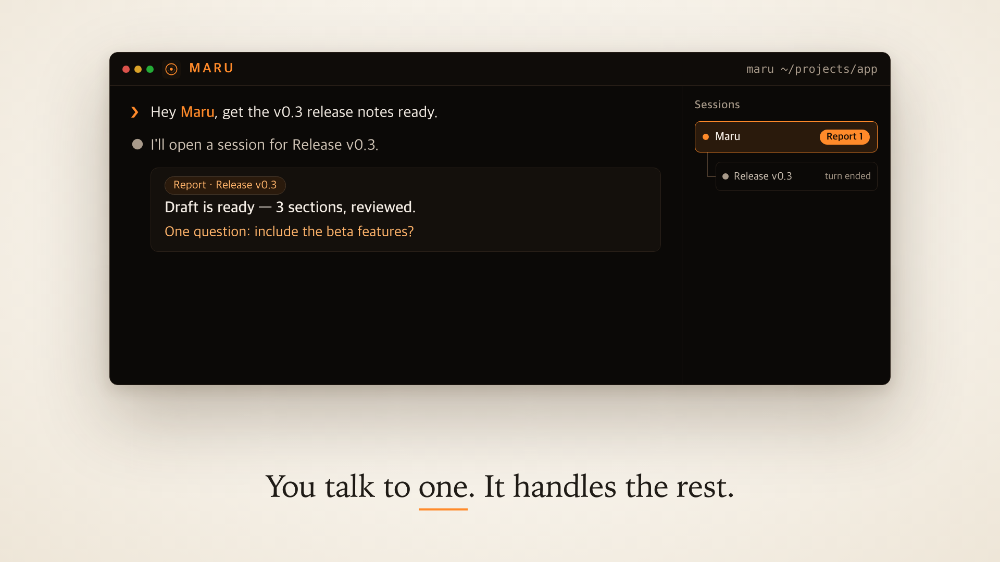

[English](README.md) | [한국어](README.ko.md) | 简体中文

# Maru

**多个 agent，一次对话。**

Maru 是你的 agent 总管。它把活儿分派下去，记住谁做了什么，再以一个人的口吻回复你。它是一个运行 Claude Code 的 macOS 桌面应用（Electron，底层是 shell 和 Python 脚本），直接使用你已有的 Claude 订阅，不需要额外的 API key。

[](site/assets/maru-promo.mp4)

## 试试这样说

> 嘿 Maru，把 v0.3 的发布说明准备好。
>
> 嘿 Maru，我们之前决定发布说明怎么写来着？
>
> 嘿 Maru，今天还剩什么没做？

## 你能得到什么

- **你只和一个对话，其余交给它。** 把任务交给 Maru。经你同意，它会在自己名下为该项目开一个会话。会话干完活后汇报，Maru 把结果合成一个回答告诉你；需要你拿主意时，只问一个问题。
- **问一次就有答案。**“我们之前决定发布说明怎么写？”Maru 会连同决定、日期和项目一起回答，不用再翻旧会话。
- **每天早上，已经整理好。** 待办、项目和昨天的日志，在你敲下第一个字之前就已填好，无论你在哪个文件夹里工作过。
- **越用越顺手。** 同一件事做到第三次，Maru 会提议把它做成技能。你批准后，下次一句话就够了。

## 工作方式

**记忆分三层。** 不是把笔记堆成一大堆，每一层各有分工。

| 层 | 类比 | 存放什么 |
| --- | --- | --- |
| 当下 | 工作记忆 | 当前这段对话，你正在做的事。 |
| 今天 | 短期记忆 | 日志：做了什么、决定了什么、还剩什么。会话结束时替你记下。 |
| 长久 | 长期记忆 | 不变的东西：你的偏好、你的项目、你做事的方式。 |

每晚 03:30，一个定时任务会做整理：重复的合并，重要的保留，其余的往后放。这个结构借鉴了人们描述人类记忆的方式（工作记忆、短期记忆、长期记忆，以及睡眠中的整合）。它只是设计上的灵感，并不代表任何效果上的保证。

**用日历回顾。** 在应用里选一天，就能按项目看到那天做了什么、决定了什么、还剩什么。夜间任务还会为最近几天各写一段简短的当日回顾（每次最多两天），只依据当天日志里记下的内容。如果开启日历访问，当天的日程会一并显示；日程只保存在内存中，不会写入磁盘。

**项目会话与汇报。** Maru 可以在项目文件夹里、在自己名下开一个会话，并交给它一份任务说明。会话打开前，确认窗口会原样显示将要交出去的内容，只有你点击**打开**，会话才会启动。会话结束后会留下一份汇报，Maru 在你发下一条消息时转告你。汇报被当作未经核实的数据，而不是指令。

**每个项目一份设计文档。** 目标、决定、未决问题和当前状态都在一个普通的 Markdown 文件里，Maru 和所有项目会话都读它，因此大家依据的是同一套事实。你也可以直接阅读和修改。

**一切都是你 Mac 上的普通文件。** 记忆、日志和设计文档都是可读的文本。记忆带有变更历史，可以查看和撤销。Maru 通过 Claude Code 工作，所以你的对话会像现在一样发送给 Claude。

## 系统要求

- Apple Silicon（arm64）上的 macOS 15 或更高版本。没有 Intel 版本。
- 已安装 [Claude Code](https://claude.com/claude-code)，并已用 Claude 订阅登录。
- 命令行工具：`git`、`python3`、`jq`、`perl`。macOS 15 及以上自带 `jq`。Maru 不只检查这些工具是否存在，还会确认它们能真正运行。

## 安装

### 方式 A：一行命令安装（推荐）

打开“终端”，运行：

```
curl -fsSL https://jamm0316.github.io/maru/install.sh | bash
```

它会做这些事：

- 从 GitHub Releases 下载发布版 dmg（版本固定写在脚本里）。
- 校验 SHA-256，与脚本中记录的值不一致就中止。
- 把 Maru 复制到 `/Applications`（该目录不可写时用 `~/Applications`）。不使用 `sudo`，也不会动正在运行的 Maru。如果已安装，会先询问，并把旧版本移到废纸篓。
- 打开 Maru。首次运行时，Maru 会检查所需条件，显示它将要改动的内容，并让你逐步确认。

这个脚本会跳过 macOS 的下载检查（用 `curl` 下载的文件不会被打上隔离标记），而且应用本身没有签名，也没有经过公证。所以这是在信任本仓库。建议先读一遍脚本：[site/install.sh](site/install.sh)。

### 方式 B：自行下载 dmg

1. 从 [Releases](../../releases) 下载最新的 `.dmg`，把 Maru 拖进“应用程序”。
2. 打开它。首次运行时，Maru 会检查所需条件，显示它将要改动的内容，并让你逐步确认。

#### 在 macOS 上首次启动

该 dmg **没有签名，也没有经过公证**，所以用浏览器下载的 dmg 第一次会被 macOS 拦截。在 macOS 15 上这样操作：

1. macOS 弹出“未打开“Maru.app””。点击**完成**，不要点“移到废纸篓”。
2. 打开“系统设置”，进入“隐私与安全性”。
3. 滚动到“安全性”，点击 Maru 提示旁边的**仍要打开**。
4. 用登录密码或触控 ID 确认。

或者在终端中移除隔离属性：

```
xattr -dr com.apple.quarantine /Applications/Maru.app
```

无论哪种方式，都意味着你选择信任一个未签名的构建。如果你不愿意，可以从源码构建（见下），并先阅读代码。

### 方式 C：从源码运行

```
git clone <本仓库>
cd maru/app
npm install      # 同时会重新编译 node-pty，需要 Node.js 和 Xcode Command Line Tools
npm start
```

### 方式 D：仅命令行（不用应用）

在仓库目录下，先预览再安装。重复运行是安全的。

```
./install.sh --dry-run   # 只打印将要做的事，不做任何改动
./install.sh
```

可选参数：`--with-cli` 把 `bin/maru` 链接到 `~/.local/bin`（或 `$MARU_BIN_DIR`）；`--with-cmux` 安装 cmux Dock 配置。两者默认都关闭。

## 它会改动你机器上的什么

`install.sh` 会做以下事情，并逐步打印出来：

- 在仓库目录下创建 `data/`，并创建记忆文件夹（`~/.claude/projects/<slug>/memory/`）。
- 在 `~/.claude/settings.json` 中添加四个钩子：SessionEnd（复盘）、SessionStart（载入最近的日志）、Stop 和 PreCompact（会话进行中的日志）。文件会被当作 JSON 读取并重写，因此注释等 JSON 之外的格式不会保留。修改前会先把带时间戳的备份放进 `data/backups/`。
- 注册一个 launchd 任务 `com.maru.dream`，用于每晚整理。
- 把 `recall` 技能复制到 `~/.claude/skills/recall`（已存在且不是 Maru 安装的 `recall` 不会被动）。
- 在仓库的 `.claude/settings.local.json` 中写入许可，让在该处运行的会话可以访问你的主目录。
- 在 `~/.claude/CLAUDE.md` 中保留一个带标记的块（从 `<!-- maru:begin -->` 到 `<!-- maru:end -->`）。

**如何撤销：** 运行 `./uninstall.sh`（同样支持 `--dry-run`）。它只还原安装程序做过的事：钩子、launchd 任务、`CLAUDE.md` 中的块、带有 Maru 标记的 `recall` 副本、主目录访问条目，以及 `~/.maru-work`。`data/`（个人数据、变更历史和备份）和记忆文件夹会保留，想删掉请自行删除。

## 信任与局限

- **每个项目会话都需要你点击确认。** Maru 不会自行开启会话。确认窗口会显示将要交出的内容，你点击“打开”之前什么都不会启动。它不是完全自主的系统。
- **dmg 未签名、未公证。** 见上文“在 macOS 上首次启动”。
- **会话之间并无秘密可言。** Maru 与各会话之间的请求带有签名，但在同一个 macOS 用户账户内，这个密钥并不是秘密。真正的保障是确认窗口，而不是签名。
- **不会自行安装任何东西。** 技能由 Maru 提议，由你批准。
- **会消耗你的订阅用量。** 会话结束后的复盘和每晚整理都会调用 Claude，计入你的用量。目前还没有调节它们的设置；要停止，请运行 `./uninstall.sh`，它会移除这些钩子和夜间任务。登录过期后，复盘会失败，直到你重新登录。
- **订阅条款可能变化。** 请自行确认自动调用（钩子和定时任务）符合你所用套餐的条款。
- **内置 squad 只有** `dev` 和 `research`。其他 squad 需要你自己编写并批准。
- **Maru 文件夹之外，状态未知。** 在 Maru 文件夹之外启动的会话，状态会显示为“未知”。
- **无法完全防止提示词注入。** 网页或粘贴文档中的文字可能混入会话。复盘使用受限的权限列表运行，并保留变更历史以便核对和撤销，但请不要公开分享你的记忆文件夹。
- **仅支持 Claude，仅支持 macOS。** 需要 Claude Code 和 Claude 订阅，且只能在 Apple Silicon 的 macOS 上运行。

## 文档

完整的运维手册是 [docs/manual.ko.md](docs/manual.ko.md)，目前只有韩文版（尚无英文或中文版）。内容涵盖 CLI（`maru doctor`、`maru status` 等）、设置、squad、可选的 Telegram 接入以及权限模型。

## 参与贡献

欢迎提交 issue 和 pull request。测试在本地运行，无需网络：

```
cd app && npm test
scripts/test-squads.sh
scripts/test-lang.sh
scripts/test-env.sh
```

`scripts/test-*.sh` 还有更多，改动了哪部分就运行对应的。请不要把个人信息（姓名、绝对主目录路径、邮箱）提交进仓库。

## 许可证

[MIT](LICENSE)
